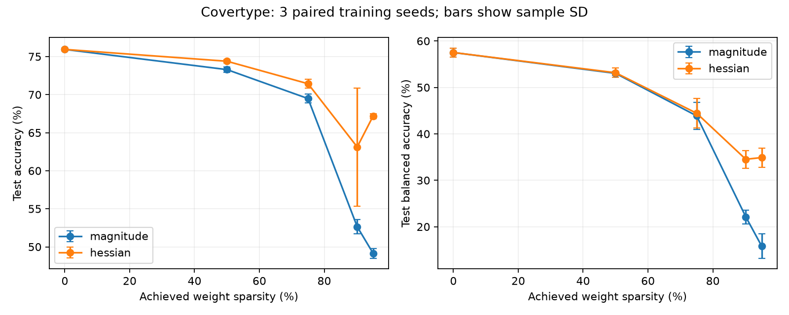

# Self-pruning network

This repository builds a classifier with NumPy. It includes our own reverse-mode
autodiff engine, Adam optimizer, and gradual weight pruning. The main experiment
uses the [UCI Covertype dataset](https://archive.ics.uci.edu/dataset/31/covertype).
The original 11 MB data archive is included in `data/` so a clone can run offline.

## Run it

Use Python 3.10 or newer. Run these commands from the repository root:

```sh
python3 -m venv .venv
source .venv/bin/activate
python -m pip install -r requirements.txt

# Part 1: gradient checks, then the full test suite
python -m pytest tests/test_engine.py -q
python -m pytest -q

# Part 2: train a dense classifier and save a learning curve
python -m train.run --method dense --out results/dense

# Part 3: train while pruning and save a learning curve
python -m train.run --method hessian --sparsity 0.9 --out results/pruned

# Part 4: reproduce the Covertype comparisons and plot
python -m train.covertype_full
```

The core uses only Python and NumPy. Matplotlib makes plots; pytest runs tests.
The full Covertype command trains 27 models and takes several minutes. It writes
the full curve to `results/covertype/`.

## Part 4: measured results

Covertype has 581,012 rows, 54 inputs, and seven classes. We use a fixed,
stratified 60/20/20 row split: 348,605 training, 116,202 validation, and
116,205 test rows. Only training rows set the scale of the first ten numeric
inputs. The other 44 inputs stay binary. The model is `54 -> 8 -> 7`: 488
prunable connection weights and 15 retained biases.

Each method uses the same initialization, batches, 60 epochs, and three training
seeds. Pruning follows a cubic ramp from epoch 15 to 45, with 15 more epochs to
recover. We measure curvature on 128 fixed training rows. Test data does not
score weights or select a checkpoint.

We estimate the loss change from deleting weight `w[i]` with:

```text
estimated loss change = -gradient[i] * w[i]
                      + 0.5 * stable_H[i,i] * w[i]**2
```

This comes from a second-order Taylor expansion with the change to that weight
set to `-w[i]`. The first term remains because pruning happens during training.
We shift the numerical Hessian to make its smallest eigenvalue positive, then
remove the lowest-scoring active weights. A mask makes each removed weight
exactly zero. The optimizer clears its value and state. Biases remain active.

The normal, unpruned model has **75.94% mean test accuracy** across the three
seeds. The table puts it on the 0% row.

| Target | Active weights | Dense test accuracy | Hessian test accuracy | Magnitude test accuracy | Balanced accuracy | Linear FLOPs/example |
|---|---:|---:|---:|---:|---:|---:|
| 0% | 488 | 75.94% | — | — | 57.52% | 991 |
| 50% | 244 | — | 74.39% | 73.29% | 53.17% | 503 |
| 75% | 122 | — | 71.44% | 69.49% | 44.45% | 259 |
| 90% | 48 | — | 63.12% | 52.64% | 34.53% | 111 |
| 95% | 24 | — | 67.20% | 49.14% | 34.90% | 63 |

Values are mean ordinary test accuracy over three seeds. Balanced accuracy
averages recall across all seven classes. Its 0% value is dense; other values
are Hessian. Achieved sparsity is 90.16% and 95.08%
at the last two targets because weight counts are integers. The 95% model keeps
24 weights **plus 15 biases**. It has fewer counted linear operations than the
dense model, but its sparse Python forward path was slower in wall-clock time.
At 95%, the measured dense export took 12.0 microseconds per batch and the
sparse export took 34.1 microseconds per batch. The FLOP count excludes
activation, indexing, allocation, and memory traffic.

**Falsifiable claim:** On this fixed Covertype split, at 95.08% achieved weight
sparsity, Hessian pruning has 67.20% mean test accuracy versus 49.14% for
magnitude pruning. It wins in all three paired seeds. The mean paired gap is
18.06 percentage points, with a 0.98-point sample standard deviation. See the
[per-seed differences](results/covertype/sweep_pairs.json) and
[raw summary](results/covertype/sweep_summary.csv).

The three paired gaps at 95% are 18.56, 16.93, and 18.69 points. That pattern
is consistent on this split, but three seeds do not measure variation across
new datasets. In one magnitude run, no output connection survived; the large
gap partly reflects that baseline collapse.



The curve is exploratory. We saw the 90% test results before adding the other
standard targets. We did not use this test set to choose a checkpoint or a
threshold, but the combined grid is not a preregistered test. Three seeds on
one row split do not prove broad superiority. Nearby forest cells may occur in
different splits. High sparsity also loses less common classes: at 95%, Hessian
balanced accuracy is 34.90%, versus 57.52% for the dense model. The 90% point
varies widely across seeds. Separate targets can select different sparse paths,
so final accuracy need not fall monotonically as weights are removed.

The [experiment report](results/covertype/SWEEP.md) includes the full table and
limits. Each model has saved weights, masks, learning history, and class counts.
The [audit](results/covertype/sweep_audit.json) records the source fingerprints
and verification checks. Rerunning the command uses the current code and
records a new fingerprint.

## Design and scope

[DESIGN.md](DESIGN.md) explains the gradient rules, mask and Adam policy,
Hessian calculation, cost, and serving limits. The full Hessian is computed, but
only its diagonal and a global stability shift affect ranking. We do not make
an Optimal Brain Surgeon compensation update. The test suite checks finite
differences, broadcasting, mask transitions, and saved-model behavior.
