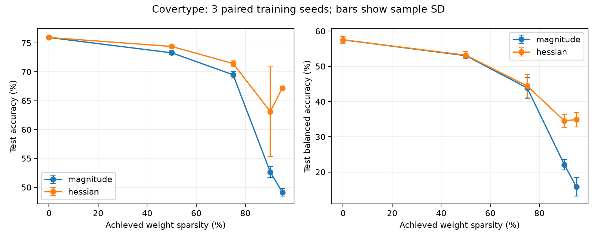

# Self-Pruning Neural Network

Hessian-guided pruning of small neural networks during training. The method
uses gradient and curvature information to rank connections,
then removes low-scoring weights under a target sparsity budget.

Built with Python and NumPy, the project includes a custom reverse-mode autodiff
engine, MLP, Adam optimizer, gradual pruning schedule, and sparse inference path.
Experiments compare Hessian-guided pruning with magnitude pruning and a dense
baseline on the [UCI Covertype dataset](https://archive.ics.uci.edu/dataset/31/covertype).
The original 11 MB data archive is included in `data/` so a clone can run offline.

## Install

Use Python 3.10 or newer. Clone the repository and install its dependencies:

```sh
git clone https://github.com/mohd-adeeb011/self-pruning-network.git
cd self-pruning-network
python3 -m venv .venv
source .venv/bin/activate
python -m pip install -r requirements.txt
```

On Windows PowerShell, activate with `.venv\Scripts\Activate.ps1` instead.
Run all remaining commands from the repository root with this environment active.

## Train and compare

Start with the small synthetic two-moons dataset:

```sh
python -m pytest -q
python -m train.run --dataset moons --method dense --out runs/dense
python -m train.run --dataset moons --method magnitude --sparsity 0.9 --out runs/magnitude
python -m train.run --dataset moons --method hessian --sparsity 0.9 --out runs/pruned
```

`--sparsity 0.9` removes at least 90% of connection weights; biases stay active.
Each output folder contains `metrics.json`, `model.npz`, and `learning.png`.
New runs go under `runs/`, which Git ignores. Use `python -m train.run --help`
to see options for the seed, model width, epochs, batch size, and pruning schedule.

To reproduce the Covertype benchmark in a separate output folder, run both
commands in order:

```sh
python -m train.covertype_experiment --out runs/covertype
python -m train.covertype_sweep --out runs/covertype
```

The core uses only Python and NumPy. Matplotlib makes plots; pytest runs tests.
The full Covertype benchmark trains 27 models and takes several minutes,
depending on hardware. It saves the sparsity curve, CSV summaries, and per-seed
models under `runs/covertype/`. Published results are in `results/covertype/`.

## Predict with a saved model

For the two-feature model trained above, load its weights and preprocessing:

```python
import numpy as np
from train.run import load_model
from prune.inference import SparseExport

model, (mean, scale) = load_model("runs/pruned/model.npz")
raw_features = np.array([[0.1, 0.2], [1.0, 0.5]])
features = (raw_features - mean) / scale
labels = SparseExport(model)(features).argmax(axis=1)
print(labels)
```

Supply feature columns in the same order as training. Predictions are zero-based
class indices. The sparse export skips removed connections, but the measured
Python implementation is slower than dense inference on this small model.

## Use your own dataset

Add a loader in [train/data.py](train/data.py), then register its name in
`Config.validate()` and the CLI dataset choices in [train/run.py](train/run.py).
Return `train`, `val`, and `test` as `(X, y)` pairs, with 2D feature arrays and
integer labels from `0` to `number_of_classes - 1`. Also return `normalization`
as `(mean, scale)`, fitted on training rows only. Apply that normalization to
all three splits before returning them. This implementation works with the
NumPy MLP defined in this repository.

## Measured results

Covertype has 581,012 rows, 54 inputs, and seven classes. We use a fixed,
stratified 60/20/20 row split: 348,605 training, 116,202 validation, and
116,205 test rows. Only training rows set the scale of the first ten numeric
inputs. The other 44 inputs stay binary. The model is `54 -> 8 -> 7`: 488
prunable connection weights and 15 retained biases.

Each method uses the same initialization, batches, 60 epochs, and three training
seeds. Pruning follows a cubic ramp from epoch 15 to 45, with 15 more epochs to
recover. We measure curvature on 128 fixed training rows. Test data does not
score weights or select a checkpoint.

We estimate the loss change from deleting weight `w[i]` with:

```text
estimated loss change = -gradient[i] * w[i]
                      + 0.5 * stable_H[i,i] * w[i]**2
```

This comes from a second-order Taylor expansion with the change to that weight
set to `-w[i]`. The first term remains because pruning happens during training.
We shift the numerical Hessian to make its smallest eigenvalue positive, then
remove the lowest-scoring active weights. A mask makes each removed weight
exactly zero. The optimizer clears its value and state. Biases remain active.

The normal, unpruned model has **75.94% mean test accuracy** across the three
seeds. The table puts it on the 0% row.

| Target | Active weights | Dense test accuracy | Hessian test accuracy | Magnitude test accuracy | Balanced accuracy | Linear FLOPs/example |
|---|---:|---:|---:|---:|---:|---:|
| 0% | 488 | 75.94% | — | — | 57.52% | 991 |
| 50% | 244 | — | 74.39% | 73.29% | 53.17% | 503 |
| 75% | 122 | — | 71.44% | 69.49% | 44.45% | 259 |
| 90% | 48 | — | 63.12% | 52.64% | 34.53% | 111 |
| 95% | 24 | — | 67.20% | 49.14% | 34.90% | 63 |

Values are mean ordinary test accuracy over three seeds. Balanced accuracy
averages recall across all seven classes. Its 0% value is dense; other values
are Hessian. Achieved sparsity is 90.16% and 95.08%
at the last two targets because weight counts are integers. The 95% model keeps
24 weights **plus 15 biases**. It has fewer counted linear operations than the
dense model, but its sparse Python forward path was slower in wall-clock time.
At 95%, the measured dense export took 12.0 microseconds per batch and the
sparse export took 34.1 microseconds per batch. The FLOP count excludes
activation, indexing, allocation, and memory traffic.

**Key result:** On this fixed Covertype split, at 95.08% achieved weight
sparsity, Hessian pruning has 67.20% mean test accuracy versus 49.14% for
magnitude pruning. It wins in all three paired seeds. The mean paired gap is
18.06 percentage points, with a 0.98-point sample standard deviation. See the
[per-seed differences](results/covertype/sweep_pairs.json) and
[raw summary](results/covertype/sweep_summary.csv).

The three paired gaps at 95% are 18.56, 16.93, and 18.69 points. That pattern
is consistent on this split, but three seeds do not measure variation across
new datasets. In one magnitude run, no output connection survived; the large
gap partly reflects that baseline collapse.



The curve is exploratory: the 50%, 75%, and 95% targets were added after reviewing
the 90% test results. Test data was not used to choose a checkpoint or a pruning
threshold. Three seeds on one row split do not prove broad superiority.
Nearby forest cells may occur in different splits. High sparsity also loses
less common classes: at 95%, Hessian
balanced accuracy is 34.90%, versus 57.52% for the dense model. The 90% point
varies widely across seeds. Separate targets can select different sparse paths,
so final accuracy need not fall monotonically as weights are removed.

The [experiment report](results/covertype/SWEEP.md) includes the full table and
limits. Each model has saved weights, masks, learning history, and class counts.
The [audit](results/covertype/sweep_audit.json) records the source fingerprints
and verification checks. Rerunning the command uses the current code and
records a new fingerprint.

## Design and scope

[DESIGN.md](DESIGN.md) explains the gradient rules, mask and Adam policy,
Hessian calculation, cost, and serving limits. The full Hessian is computed, but
only its diagonal and a global stability shift affect ranking. We do not make
an Optimal Brain Surgeon compensation update. The test suite checks finite
differences, broadcasting, mask transitions, and saved-model behavior.

## License

A code license has not yet been selected. The included Covertype dataset has
separate [CC BY 4.0 terms and attribution](data/README.md).
